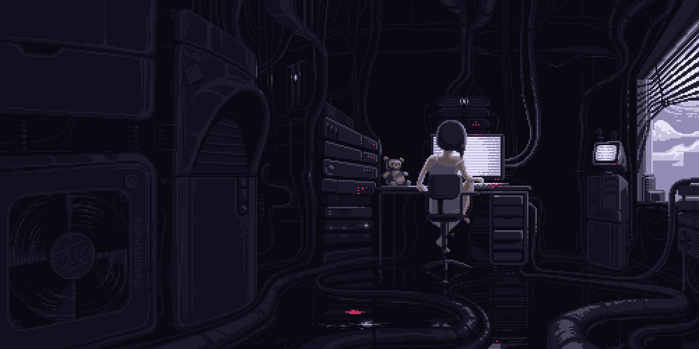

  

<h1 align="center">Hi 👋, I'm Sam</h1>

<h3 align="center">CS Student • Builder • Always Learning</h3>

  

---

<h2 align="center">🚀 About Me</h2>

Hey! I'm **Sami**, a **Computer Science student** who loves to build things, experiment with new ideas, and learn more every day.

- 🛠️ **Building & Creating**: Turning ideas into real apps and projects just to see them come to life.
- 🧪 **Trying New Things**: Exploring different tools, technologies, and ways of solving problems.

 

---

<h2 align="center">🧩 LeetCode Stats</h2>

  

---

<h2 align="center">🤝 Connect</h2>

  
  &nbsp;&nbsp;&nbsp;
  

---

<h2 align="center">🏛️ Operating Philosophy </h2>

  

  <i>"Waste no more time arguing what a good man should be. Be one."</i> — <b>Marcus Aurelius</b>

